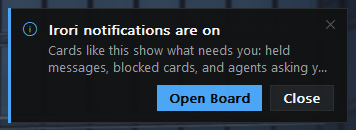
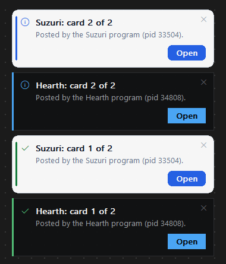

# rust-toast

Native notification cards for Rust apps on Windows and macOS. Cards stack
in a corner of the screen you're on, sit over every window, never take
focus, and can carry a thumbnail, up to two buttons, a sound and a burst of
confetti on good news.



Website, with a live demo of the motion: <https://stephenshorton.github.io/rust-toast/>

They are custom-drawn windows, not the OS notification centre:

- **Windows:** layered, topmost, `WS_EX_NOACTIVATE` tool windows on one
  dedicated UI thread with its own message loop. Real glass (acrylic) on
  Windows 11, solid elsewhere.
- **macOS:** non-activating `NSPanel`s at status-window level, on the
  AppKit main thread your app already runs (Tauri does). Glass through
  `NSVisualEffectView`.
- **Elsewhere:** every call is a no-op.

It's a Rust port of [go-toast](https://github.com/StephenSHorton/go-toast)
v0.2.0. It grew up inside Irori and is shared by suzuri and other apps.

## Use

```toml
[dependencies]
rust-toast = { git = "https://github.com/StephenSHorton/rust-toast", tag = "v0.7.0" }
```

```rust
use toast::{Action, Config, Kind, Note};

// Once, at startup: the look (palette, scheme, corner radius, glass).
toast::configure(Config { app_name: "My App".into(), ..Config::default() });

toast::post(Note {
    title: "Build finished".into(),
    body: "All tests passed.".into(),
    kind: Kind::Success,
    actions: vec![Action::new("Open", || println!("open"))],
    ..Note::default()
});
```

- `Note::id` replaces a live card in place instead of stacking a new one;
  `toast::close(id)` takes it down (its callbacks don't run).
- `toast::dismiss_all()` takes every card down, sticky ones too, as if
  each one's x were pressed: each slides out and its `on_dismiss` runs.
- `sticky` cards stay until clicked or dismissed; others expire (hovering
  pauses the timer).
- `toast::set_options` takes the person's settings: on/off, corner, sound and
  volume, confetti.
- `Config::capture_exclude` (on by default) keeps cards out of screenshots
  and screen recordings.
- `Note::accent` gives one card its own colour (`CardAccent { light, dark }`)
  for its stripe, icon and first button, in place of the palette's accent
  for its kind; left `None` the card takes the palette's.
- `Config::stripe` (on by default) draws the kind-coloured bar down the
  card's left edge; off, the icon alone carries the colour.
- `Config::clear_all` (on by default) shows a **Clear all · N** button past
  the newest card while the stack is hovered open with two or more cards;
  clicking it calls `toast::dismiss_all()`. Off, there is no button.
- `Config::motion` (`toast::Motion`) tunes the stack: past three cards the
  older ones fold into a deck in the corner, hovering opens it, a sideways
  drag throws a card away, and everything animates (see [Motion](#motion)).

- Programs that use rust-toast share one stack per corner: see
  [One stack for every program](#one-stack-for-every-program).

Try it: `cargo run --example demo` (`cargo run --example demo 20 6` keeps
it up 20 s with six cards, enough to fold a deck).

## From other languages

`rust-toast`, a small program behind the `cli` feature, gives the cards to
apps not written in Rust. Spawn `rust-toast serve` and keep it running:
it reads one JSON command a line on stdin (`configure`, `set_options`,
`post`, `close`, `dismiss_all`, `list`, `quit`) and writes one JSON event a line on
stdout (`ready`, `posted`, `action`, `click`, `dismiss`, `cards`, `error`).
It exits when its stdin closes, so it never outlives the app.

```sh
cargo build --release --features cli
(echo '{"cmd":"post","title":"Hello","kind":"success"}'; sleep 4) | target/release/rust-toast serve
rust-toast --title "Backup finished" --kind success   # one card from a script
```

[PROTOCOL.md](PROTOCOL.md) is the protocol (versioned, with examples);
[examples/node-client.mjs](examples/node-client.mjs) is a client in Node
with no dependencies. Tagged releases attach the program for Windows x64
and macOS (universal) with SHA-256 checksums.

## One stack for every program

Every program on the computer that uses rust-toast (0.7.0 or later; 0.6.x
programs share only with each other) and
shows its cards in the same corner shows them in **one stack**, instead of
each drawing its own stack on top of the others. Nothing to call: it is how
`post` works. The same goes for apps using the `rust-toast` program.



- The first program to post in a corner draws that corner's stack; the
  others send it their cards over a loopback link and get back what the
  person did (a button, a click, a dismiss), so each program's callbacks
  still run in that program.
- Each card keeps its own program's look (palette, scheme, radius, glass,
  stripe, capture exclusion); each program plays its own sounds at its own
  volume. The stack itself (hover, the deck, `max_cards`, *Clear all*,
  motion) is the drawing program's.
- `toast::close`, `toast::dismiss_all()` and `Note::id` reach only the
  calling program's cards. *Clear all* on the stack clears them all.
- When the drawing program quits, another takes the corner over and every
  program's live cards come back in its stack (with the time each had
  left). A program whose person turns cards off or moves them to another
  corner leaves this corner's stack the same way.
- Programs in different corners keep separate stacks.
- How: like rsz-caffeine's shared switch, a folder the programs agree on,
  `%LOCALAPPDATA%\rust-toast\share-v2` on Windows and
  `~/Library/Application Support/rust-toast/share-v2` on macOS. The drawing
  program holds an OS lock on `<corner>.lock` (released when it quits,
  however it quits) and writes its loopback port and a random token to
  `<corner>.addr`; it takes no link without the token. The `v2` is the wire
  version (0.6.x used `v1`): programs on different wire versions never
  share. If the folder
  or the link fails, a program draws its own cards as before.
  `RUST_TOAST_SHARE_DIR` moves the folder (the tests use it).

Try it: `cargo run --example shared -- Hearth dark 2 12` and, at once in
another terminal, `cargo run --example shared -- Suzuri light 2 10 600`.

## Motion

The stack is a list with a deck in the corner:

- **One column** from the corner out: the oldest card at the corner, the
  newest farthest out.
- **At rest** the newest three are in full. Older ones fold into a deck
  that stays in the corner: the newest of them in front, up to two
  peeking out toward the corner behind it, each a step smaller and
  fainter, cut to the front card's height.
- **Hover** opens the stack. If every card fits the screen in one column,
  they all show; otherwise as many as fit, with a deck at each end,
  opening on the newest. The **wheel** (or a vertical drag on a card)
  moves one card per notch; wheel up goes toward the newer cards in a
  bottom corner, toward the older in a top one.
- **Clear all**: open with two or more cards, a small *Clear all · N*
  button (N the cards up) sits a gap past the newest card, at the corner's
  side, in the cards' look. It is part of the stack (moving onto it, or
  across the gap, keeps the stack open), and a click dismisses every card.
  When it appears or moves under a still pointer (the newest card's x
  pressed, say), it takes no click until the pointer moves, so a
  double-click on that x never clears the rest.
  Its row comes off the room the open stack has.
- **Leaving** folds it again at once, except just after a card was thrown
  away: then it waits 1.2 s, time to come back for the next one. Nothing
  expires while the stack is open.
- **Drag a card sideways** to throw it away (past 110 dip, or a quick
  flick): it follows the pointer and fades, and a throw counts as the
  person's dismiss (`on_dismiss`). Short of that it springs back. The
  first 12 dip of a drag pick its axis for the whole drag; a press dragged
  off a card is never a click.
- Everything moves with a springy 420 ms ease: new cards slide in from the
  screen edge, closing ones slide toward it and fade, thrown ones fly off,
  and the rest glide into their new places. With the OS's reduce-motion
  setting on (Windows: Animation effects off; macOS: Reduce motion) every
  move jumps to its end.

All of it is `Config::motion` (`toast::Motion`), with the designed
values as `Motion::default()`:

| Field | Default | What |
| --- | --- | --- |
| `shown` | 3 | cards in full at rest |
| `max_cards` | 5 | cards up at once; a post past it pushes the oldest non-sticky one off (in a shared stack, any program's) |
| `peek`, `peek_depth` | 12 dip, 2 | how far and how many cards peek out behind a deck's front |
| `peek_shrink`, `peek_fade` | 0.05, 0.22 | each step back: smaller, more transparent |
| `lock` | 12 dip | drag that decides its axis |
| `dismiss_distance`, `flick_speed` | 110 dip, 0.6 dip/ms | a release past either throws the card |
| `drag_fade`, `drag_min_opacity` | 260 dip, 0.2 | a dragged card fades over this distance, to this |
| `scroll_step` | 44 dip | vertical drag per card scrolled |
| `rubber_band` | 0.15 | give of a vertical drag with nothing to scroll |
| `wheel_debounce` | 90 ms | wheel steps closer than this count once |
| `after_throw` | 1200 ms | how long the stack stays open after a throw |
| `duration`, `exit` | 420 ms, 0.8 | every move; leaving takes this fraction |
| `ease`, `ease_out` | `[.2, .9, .25, 1.15]`, `[.2, .8, .2, 1]` | cubic-bezier for moves (springy) and fades |
| `enter_offset`, `enter_scale` | 60 dip, 0.96 | where a new card slides in from |
| `leave_offset`, `throw_offset` | 40 dip, 420 dip | how far closing and thrown cards travel |

`max_cards` keeps the old limit of 5 by default, so a deck holds at most
two cards and the two-ended open stack only shows on a short screen; raise
it to keep more.

**Wheel on Windows:** the cards never take focus. With "Scroll inactive
windows when I hover over them" on (the default since Windows 10) the
wheel arrives at the card under the cursor. With it off, the card thread
installs a low-level mouse hook only while the stack is open, and only
wheel steps over the stack go to it (and not to the focused app).

## Check

```sh
cargo test
cargo clippy --all-targets -- -D warnings
cargo build --example demo
RUST_TOAST_SMOKE=1 cargo test smoke   # Windows: real cards on screen
cargo test --features cli             # the program and its protocol
RUST_TOAST_SMOKE=1 cargo test --features cli cli_smoke  # Windows, macOS: real cards
```

CI (`.github/workflows/ci.yml`) runs fmt, clippy and the tests, with and
without `cli`, on Windows and macOS (and Linux, where every call is a
no-op) on every push and pull request.

The tests drive the shared engine headless with a recording surface:
layout, decks, hover, the wheel, drags and throws, timings and reduce
motion. The AppKit half (`src/darwin.rs`) runs only on a Mac;
`cargo clippy --target aarch64-apple-darwin --all-targets -- -D warnings`
type-checks it from any OS (`rustup target add aarch64-apple-darwin`),
and [MAC.md](MAC.md) lists what to build and check there.

## Sounds

`sounds/` holds the s&box editor's notification sounds, MIT, from
Facepunch Studios ([sounds/NOTICE.md](sounds/NOTICE.md)).

## Licence

MIT.
