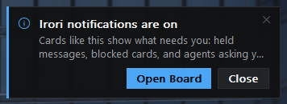

# rust-toast

Native notification cards for Rust apps on Windows and macOS. Cards stack
in a corner of the screen you're on, sit over every window, never take
focus, and can carry a thumbnail, up to two buttons, a sound and a burst of
confetti on good news.



They are custom-drawn windows, not the OS notification centre:

- **Windows:** layered, topmost, `WS_EX_NOACTIVATE` tool windows on one
  dedicated UI thread with its own message loop. Real glass (acrylic) on
  Windows 11, solid elsewhere.
- **macOS:** non-activating `NSPanel`s at status-window level, on the
  AppKit main thread your app already runs (Tauri does). Glass through
  `NSVisualEffectView`.
- **Elsewhere:** every call is a no-op.

It's a Rust port of [go-toast](https://github.com/StephenSHorton/go-toast)
v0.2.0. It grew up inside Irori and is shared by suzuri and other apps.

## Use

```toml
[dependencies]
rust-toast = { git = "https://github.com/StephenSHorton/rust-toast", tag = "v0.1.0" }
```

```rust
use toast::{Action, Config, Kind, Note};

// Once, at startup: the look (palette, scheme, corner radius, glass).
toast::configure(Config { app_name: "My App".into(), ..Config::default() });

toast::post(Note {
    title: "Build finished".into(),
    body: "All tests passed.".into(),
    kind: Kind::Success,
    actions: vec![Action::new("Open", || println!("open"))],
    ..Note::default()
});
```

- `Note::id` replaces a live card in place instead of stacking a new one;
  `toast::close(id)` takes it down.
- `sticky` cards stay until clicked or dismissed; others expire (hovering
  pauses the timer).
- `toast::set_options` takes the person's settings: on/off, corner, sound and
  volume, confetti.
- `Config::capture_exclude` (on by default) keeps cards out of screenshots
  and screen recordings.

Try it: `cargo run --example demo`.

## Check

```sh
cargo test
cargo clippy --all-targets -- -D warnings
RUST_TOAST_SMOKE=1 cargo test smoke   # Windows: real cards on screen
```

The AppKit half (`src/darwin.rs`) builds only on a Mac; [MAC.md](MAC.md)
lists what to build and check there.

## Sounds

`sounds/` holds the s&box editor's notification sounds, MIT, from
Facepunch Studios ([sounds/NOTICE.md](sounds/NOTICE.md)).

## Licence

MIT.
